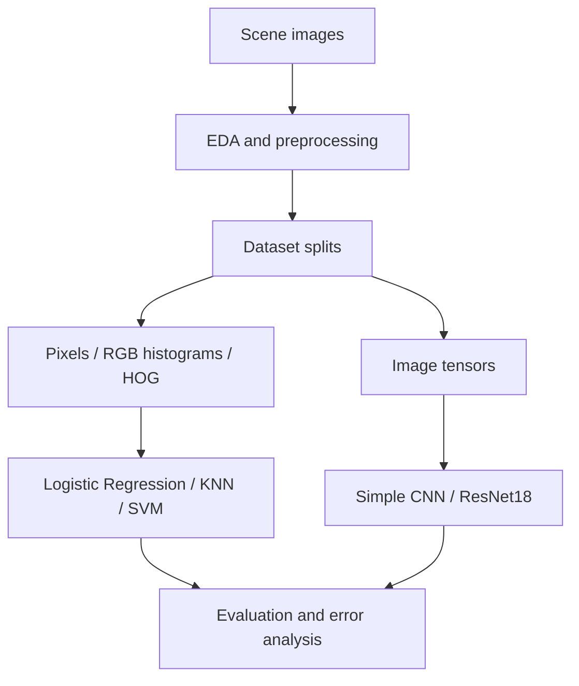

# Intel Scene Image Classification

A comparative machine learning study of handcrafted visual features, classical classifiers, convolutional neural networks and transfer learning for six-class scene recognition.

**Best reported result:** ~93% accuracy using fine-tuned ResNet18.

**Stack:** Python · NumPy · OpenCV · scikit-learn · PyTorch · torchvision · Jupyter

## Problem and dataset

Given a landscape or urban scene image, predict one of six categories: `buildings`, `forest`, `glacier`, `mountain`, `sea`, or `street`.

The project uses the [Intel Image Classification dataset](https://www.kaggle.com/datasets/puneet6060/intel-image-classification) from Kaggle. Images are processed at 150 × 150 pixels. The preprocessing workflow checks corrupted images, detects duplicates, prepares train/validation/test partitions and normalizes inputs for neural models.

## Methodology

The experiments examine how different representations affect scene recognition:

- **Classical ML:** flattened pixels, RGB histograms, HOG and combined HOG + RGB features with Logistic Regression, KNN and SVM.
- **Deep learning:** a simple CNN and fine-tuning of pretrained ResNet18.
- **Evaluation:** model tuning, comparative accuracy and analysis of confusing scene categories; CNN evaluation includes a Grad-CAM notebook.

## Experimental results

| Method | Reported accuracy |
| --- | ---: |
| HOG + Logistic Regression | ~65% |
| HOG + RGB Histogram + SVM | ~79% |
| Simple CNN | ~88% |
| Fine-tuned ResNet18 | **~93%** |

These approximate project-reported values are retained from the original experiment summary. Consult the notebooks for the corresponding splits, configurations and detailed outputs; they have not been independently rerun for this README.

### Key observations

Combined color and gradient features improve on the HOG-only baseline, while learned CNN representations achieve higher reported accuracy. Common confusions include glacier versus mountain, buildings versus street, and sea versus mountain. These categories share textures, structures or visual context that can make their boundaries ambiguous.

## Reproduce the experiments

Download the dataset using the source above. Create a Python environment with Jupyter, NumPy, OpenCV, scikit-learn, PyTorch, torchvision, Matplotlib and Gradio (for the demo). This repository does not currently provide a pinned dependency manifest, so check notebook-specific imports and data paths before execution.

| Stage | Notebook |
| --- | --- |
| Exploratory data analysis | [01_eda](notebooks/01_eda.ipynb) |
| Data preprocessing | [02_preprocessing](notebooks/02_preprocessing.ipynb) |
| Classical baselines | [03_baselines](notebooks/03_baselines.ipynb) |
| Model tuning | [04_tuning](notebooks/04_tuning.ipynb) |
| Combined visual features and SVM | [05_HOG_RGB_SVM](notebooks/05_HOG_RGB_SVM.ipynb) |
| CNN training | [06_cnn_train](notebooks/06_cnn_train.ipynb) |
| Classical model error analysis | [07_error_analysis](notebooks/07_error_analysis_for_logistic_hog.ipynb) |
| CNN evaluation and Grad-CAM | [08_cnn_evaluation](notebooks/08_cnn_evaluation_full_gradcam.ipynb) |
| Interactive SVM demo | [09_gradio_demo](notebooks/09_gradio_demo_intel_image_project_SVM_HOG_RGB.ipynb) |

The demo notebook is available for interactive exploration; a hosted service is not claimed.

## Limitations and future work

Further work includes measuring inference cost, documenting exact experiment dependencies and validating performance on images outside the dataset. Accuracy on this benchmark is not a guarantee of generalization to arbitrary scenes.

## Contributors

Academic team project — CS114 Machine Learning, University of Information Technology (VNU-HCM).

- Nguyễn Văn Phú
- Đoàn Hữu Gia Bình
- Trần Bảo Ngọc

Supervisor: Huỳnh Tân Bối.
